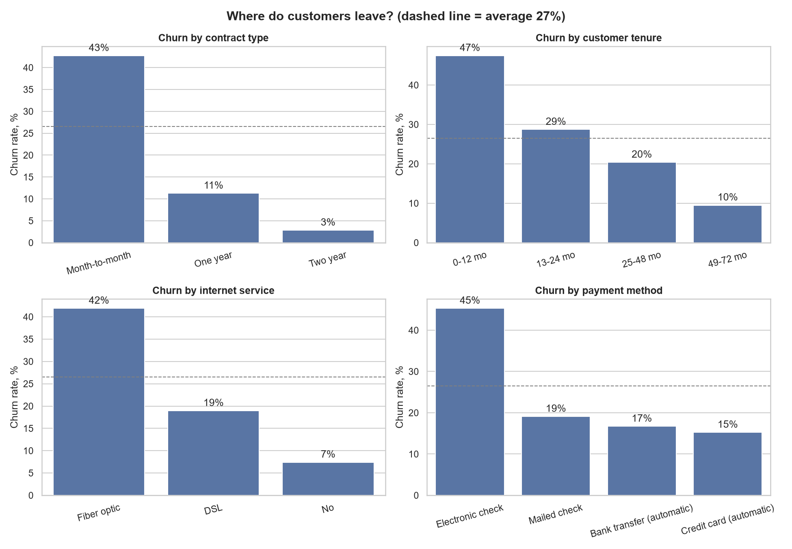
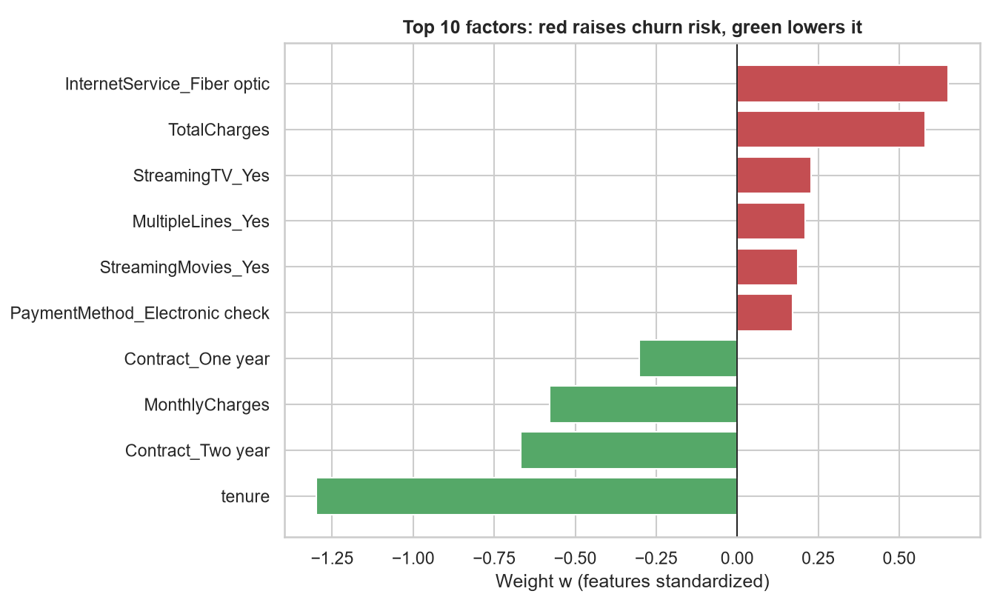

# Telco Customer Churn Prediction

Predicting which telecom customers are about to leave, and finding out **why** they leave.

Built with Python, pandas, scikit-learn, seaborn and matplotlib.

## Problem

Keeping an existing customer is cheaper than winning a new one. Given customer data (contract, tenure, services, billing), the goal is to:

1. Predict which customers will churn.
2. Identify the main factors that drive churn, so the business can act on them.

## Dataset

[Telco Customer Churn](https://www.kaggle.com/datasets/blastchar/telco-customer-churn) from Kaggle: 7,043 customers, 21 columns. About 27% of customers churned, so the classes are imbalanced.

## Approach

1. **Cleaning:** converted `TotalCharges` to numbers, filled 11 blank values with the median, encoded categorical features.
2. **Exploratory analysis:** churn rate by contract, tenure, internet service and payment method.
3. **Data split:** 60% train / 20% validation / 20% test. The test set was used only once, for the final evaluation.
4. **Models compared:** logistic regression, SGD classifier (log loss), KNN (k=25), random forest.
5. **Threshold tuning:** the decision threshold was chosen on the validation set (best F1), not on the test set, to avoid information leakage.

## Results (test set)

| Model | ROC-AUC | Recall (churned) | Precision (churned) | F1 |
|---|---|---|---|---|
| **Logistic Regression** | **0.843** | 0.690 | 0.554 | 0.614 |
| SGD (log loss) | 0.827 | 0.749 | 0.521 | 0.615 |
| KNN (k=25) | 0.823 | 0.722 | 0.524 | 0.607 |
| Random Forest | 0.825 | 0.725 | 0.520 | 0.606 |

Recall, precision and F1 are for the churned class at the tuned threshold (about 0.31 to 0.37 depending on the model).

All four models perform similarly (F1 around 0.61). **Logistic regression** was chosen as the final model: it has the best ROC-AUC and log loss, and its weights are easy to interpret.



## Key findings

- Customers on **month-to-month contracts** churn at 43%, versus 3% on two-year contracts.
- Churn is highest in the **first year** (47%) and drops to 10% after four years.
- **Fiber optic** customers churn at 42%, versus 19% for DSL.
- Customers paying by **electronic check** churn at 45%, versus 15-19% for other payment methods.



## Business recommendations

- Offer new customers a discounted one- or two-year contract.
- Investigate service quality and pricing for fiber optic customers.
- Encourage automatic payment methods.
- Use the model's churn probability to prioritize retention calls and offers. A lower threshold catches more churners at the cost of more false alarms.

## How to run

```bash
pip install -r requirements.txt
python get_data.py          # downloads the dataset from Kaggle
python churn_model_final.py # trains models, saves charts to images/
```

## Project structure

```
.
├── churn_model_final.py   # full pipeline
├── get_data.py            # downloads the dataset
├── model_comparison.csv   # metrics of all models
├── requirements.txt
└── images/                # charts
```

## Limitations and next steps

- Features were used as they are; feature engineering (for example, charges per month of tenure) may help.
- Hyperparameters were not tuned. Next steps: cross-validation, gradient boosting, SHAP values.
- The dataset is a single snapshot, so the model shows association, not causation.

## Author

ALIZHAN   | [alizhan1809@gmail.com]
